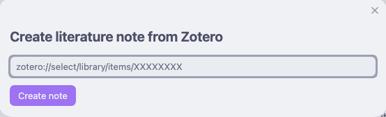
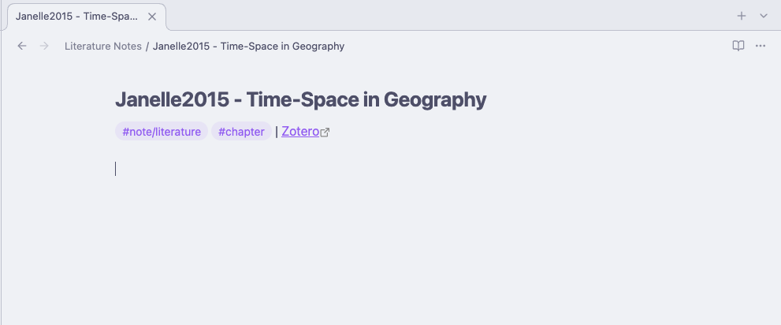
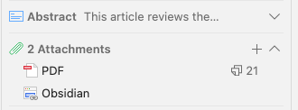

# Zotero Literature Link

Create Obsidian literature notes from Zotero links and open them directly from Zotero. Link existing notes and keep their links updated when notes move or are renamed.

## Install

1. Install [BRAT](https://github.com/TfTHacker/obsidian42-brat) in Obsidian and add `https://github.com/fab1s/zotero-literature-link`.
2. Enable Zotero Literature Link.
3. Enter your numeric user ID and an API key with library write access from [Zotero settings](https://www.zotero.org/settings/keys).

Manual installation: download `main.js`, `manifest.json`, and `styles.css` from [Releases](https://github.com/fab1s/zotero-literature-link/releases), copy them into `.obsidian/plugins/zotero-literature-link`, then reload and enable the plugin.

## Use

Run **Create literature note from Zotero link**, paste the link, and select **Create note**.

**1. Paste the Zotero link.**

**2. Write in the created note.** This example uses custom templates.

**3. After syncing, open the Obsidian attachment in Zotero.** The PDF remains separate.

For an existing note containing a Zotero link, run **Attach this note's link to its Zotero item**. Adjust folders, templates, and citation key sources in settings. Guessed keys may not match Better BibTeX.

## Important

Zotero metadata must be synced. The API key is stored unencrypted in `data.json`; never share it. Attachment links reveal your vault name and note path to people with library access.

Optional deletion removes only verified link attachments created by this version or later, never source items or PDFs. Deletion is off by default and permanent. **Dry run** skips Zotero changes while allowing local notes. After an offline move, run the attach command again when online.

Agentically engineered with OpenAI Codex under human direction. [MIT license](LICENSE).
